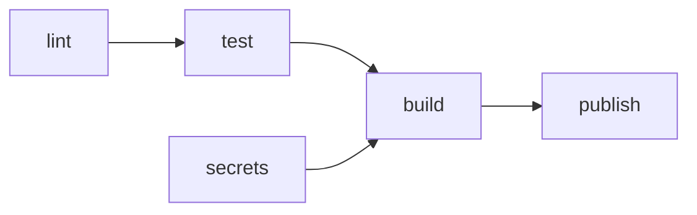

# ADR 004: CI-пайплайн

## Статус
Предложено

## Дата
2026-10-16

## Участники принятия решения
- Иван Петров — ведущий ADR, владелец репозитория
- Олег Ким — ведущий приложения А (проверки и место запуска)
- Анна Волкова — ведущая разметки шаблона (приложение Б)
- Мария Соколова — рецензент (проверяла ADR 004 команды «Библиотечный каталог»)

## Контекст

Наша команда разрабатывает «Учёт заявок на ремонт оборудования» (repair-requests) — сервис, в котором сотрудники подают заявки на ремонт, а инженеры АХО принимают и закрывают их, — в рамках курса "Управление конфигурацией бизнес-приложений".

**Характеристики проекта:**
- Размер команды: 4 человека
- Длительность проекта: 16 недель (1 семестр)
- Стратегия ветвления: GitHub Flow, PR в `main`, merge commit ([ADR 001](001-branching-strategy.md))
- Менеджер зависимостей и Python: uv, `uv.lock` в репозитории, `.python-version` = `3.14`, в образе `python:3.14-slim` ([ADR 002](002-dependency-manager.md))
- Сканер секретов: gitleaks 8.28.0 в pre-commit, `language: docker_image` (образ `zricethezav/gitleaks:v8.28.0`), режим `git --staged` ([ADR 003](003-configuration.md))
- Опыт команды с CI: workflow никто не писал; логи Actions видел Олег (в чужом open-source проекте); у нашего репозитория вкладка Actions пустая
- Требования к стабильности `main`: ruleset `protect-main` (PR, 1 approval, сброс approval новыми коммитами, закрытые обсуждения, без force-push и удаления); **Require status checks to pass — выключено**; `.github/CODEOWNERS` нет, `.github/` (только `pull_request_template.md`) правит любой с Write

**Проблема:** (приложение А)
1. Перед merge проверок 6 (issue #16): pre-commit, сборка образа, стек, `/health`, проба ключом, ruff
2. Все 6 зависят от человека или клона: pre-commit — от `pre-commit install` и Docker у того, кто коммитит; образ и стек — от ноутбука с Docker; ruff не запускает никто
3. Все вместе — около 3 мин 50 с на ноутбуке команды, из них 1 мин 49 с — pre-commit; на деле перед merge запускается только `/health` у ревьюера

**Критерии ADR 004** (доска, демо воркшопа):
- Проверка не должна зависеть от клона и человека: коммит через веб-редактор, `--no-verify` и клон без `pre-commit install` её не обходят
- Сканер должен видеть секрет в файле, который уже лежит в ветке, а не только в добавленном в коммит
- Красный статус — как можно раньше, по каждой стадии отдельно; из лога сразу видно, что упало
- Пайплайн покрывает ветки нашей стратегии: PR в `main`

## Рассмотренные варианты

| Критерий | A: pre-commit + ручные проверки | B: один джоб `pre-commit run --all-files` + сборка | C: отдельные джобы по стадиям с `needs` |
|---|---|---|---|
| Независимость от клона и человека | Нет: веб-редактор, `--no-verify`, клон без hook — проверок нет | Да, на раннере для каждого PR | Да, на раннере для каждого PR |
| Найдёт ли секрет в файле, который уже в ветке | Нет: `--staged` смотрит только добавленное | Нет: в `pre-commit run --all-files` с `--staged` gitleaks ничего не сканирует (практика №4, шаг 3.3) | Да: gitleaks `dir` по файлам ветки |
| Время до первого красного статуса | После ручного запуска, 1–4 мин, если запустили | ≈ 2 мин (оценка): pre-commit целиком, потом сборка | ≈ 1 мин (оценка): `lint` и `secrets` идут параллельно |
| Понятность лога | Вывод в терминале у одного человека | Один джоб: какой хук упал — искать в логе | Имя упавшего джоба видно в PR, шаг — в логе |
| Покрытие веток стратегии (PR в `main`) | Нет | Да, `pull_request: [main]` | Да, `pull_request: [main]` |
| Обязательные проверки ruleset | Нечего выбирать | Одна проверка на всё | По одной на стадию: `lint`, `secrets`, `test`, `build` |
| Стоимость поддержки | Каждый помнит список | Новая проверка — хук в `.pre-commit-config.yaml` | Новая проверка — шаг или джоб в `ci.yml` |
| Соответствие DoD 4 (стадии, блок merge) | Нет | Частично: стадий нет, линтеров в pre-commit нет | Да: стадии линтинга, тестов, сборки, публикации; блок merge |

### Вариант A: pre-commit + ручные проверки, как сейчас
**Суть:** при коммите работает pre-commit практики №4; остальное (образ, стек, `/health`) ревьюер запускает руками перед approval.
**Плюсы:**
- Ничего не надо настраивать
- Секрет ловится до push, если hook установлен

**Минусы:**
- Обходится веб-редактором, `--no-verify` и клоном без `pre-commit install`
- Проверки перед merge фактически не запускаются (issue #16: только `/health`)
- Линтера и типов нет совсем

**Подходит ли нам:** Нет — не закрывает раздел 4 DoD: пайплайна и блока merge нет.

### Вариант B: один джоб `pre-commit run --all-files` + сборка образа
**Суть:** в CI один джоб запускает наш `.pre-commit-config.yaml` по всем файлам, второй собирает образ.
**Плюсы:**
- Одна конфигурация проверок для коммита и для CI
- Базовые проверки файлов (`end-of-file-fixer`, `check-yaml`) тоже идут в CI

**Минусы:**
- gitleaks с `--staged` в этом прогоне ничего не сканирует — секрет в ветке пройдёт зелёным
- Одна обязательная проверка на всё: из PR не видно, какая стадия упала
- Для линтеров пришлось бы добавить их в pre-commit — каждый коммит станет ещё дольше

**Подходит ли нам:** Нет — главный риск (секрет в ветке) не закрывает.

### Вариант C: отдельные джобы по стадиям с `needs`
**Суть:** шаблон курса: `lint` (ruff, ruff format, mypy) и `secrets` (gitleaks из образа) параллельно, `test` после `lint`, `build` после всех трёх, `publish` после `build` только на push в `main`.
**Плюсы:**
- Каждая стадия — своя обязательная проверка, красная стадия видна в PR сразу
- `secrets` сканирует файлы ветки, независимо от pre-commit
- Готовый шаблон, правок под нас мало (uv, `main`)

**Минусы:**
- Надо добавить ruff и mypy в dev-зависимости и привести код к ним
- Базовые хуки `pre-commit-hooks` в CI не повторяются

**Подходит ли нам:** Да.

## Решение

Мы выбрали **вариант C** — отдельные джобы по стадиям с `needs`, по шаблону курса.

**Схема пайплайна**

| Джоб | Стадия | Что запускает | Триггер | `needs` | Время (измерено / оценка) | Обязательная проверка ruleset | Практика |
|---|---|---|---|---|---|---|---|
| `lint` | Линтинг и типы | `ruff check`, `ruff format --check`, `mypy` | `pull_request` в `main`, `push` в `main` | — | ≈ 1 мин (оценка: установка uv и зависимостей; ruff — 2,3 с, измерено) | Да, с практики №5 | №5 |
| `secrets` | Секреты | gitleaks `dir` из образа + gitleaks `git` по всей истории | `pull_request` в `main`, `push` в `main` | — | ≈ 30 с (оценка; локально `dir` — 0,7 с, `git` — 6,5 с без скачивания образа) | Да, с практики №5 | №5 |
| `test` | Тесты | `pytest` с сервисом PostgreSQL | `pull_request` в `main`, `push` в `main` | `lint` | ≈ 2 мин (оценка) | Да, с практики №6 | №6 |
| `build` | Сборка образа | `docker build` | `pull_request` в `main`, `push` в `main` | `lint`, `secrets`, `test` | ≈ 1 мин (оценка; локально без кэша — 34 с, измерено) | Да, с практики №6 | №6 |
| `publish` | Публикация образа | Вход в GHCR, сборка и push образа с тегом | только `push` в `main` | `build` | ≈ 1–2 мин (оценка) | Нет | №6 |

Сумма по самому длинному пути (`lint` → `test` → `build`) — около 4 мин (оценка), примерно как ручные проверки сейчас, но без человека и на каждый PR.

**Правила пайплайна:**
1. Схема — таблица выше; имена джобов `lint`, `secrets`, `test`, `build`, `publish` не меняем: по ним ruleset выбирает обязательные проверки
2. Триггеры: `pull_request` в `main` и `push` в `main` (GitHub Flow, ADR 001). Других долгоживущих веток нет
3. Обязательные проверки: в ruleset `protect-main` включается «Require status checks to pass»; `lint` и `secrets` — на практике №5, `test` и `build` — на практике №6. Включает владелец репозитория (Иван). Обязательной делаем каждую стадию: джоб, пропущенный из-за упавшего `needs`, считается успешным
4. Секреты в CI: gitleaks 8.28.0 из образа `zricethezav/gitleaks:v8.28.0` (не через pre-commit — с `--staged` он в CI ничего не сканирует): режим `dir` по файлам ветки PR и режим `git` по **всей истории** (`fetch-depth: 0`). Историю проверяем: проверка короткая (34 коммита — 6,5 с), находок в истории нет (ADR 003, проверено ещё раз 2026-10-16: `INF no leaks found`), `.gitleaksignore` нет — любая находка будет новой
5. Что остаётся в pre-commit: всё, как в практике №4, ничего не убираем и не добавляем. Дважды — при коммите и в CI — выполняется только gitleaks: при коммите ловит секрет до push (дёшево исправить), в CI — то, что обошло hook (веб-редактор, `--no-verify`, клон без hook). Базовые хуки (`end-of-file-fixer`, `check-yaml` и др.) остаются только в pre-commit — осознанно (замечание 2 ревью, приложение Г). ruff и mypy в pre-commit не добавляем: коммит и так идёт 1,5–2,5 мин
6. Реестр и тег образа: GitHub Container Registry, `ghcr.io/ivan-petrov/app-conf-project-repair-requests`, вход по `GITHUB_TOKEN` (права `packages: write` — только у `publish`); тег — полный SHA коммита (`type=sha,format=long`). Тег версии из `main.py` (ADR 003, п. 5) пока не добавляем — решим на практике №6

## Обоснование решения

**Почему мы выбрали именно этот вариант?**

1. **Независимость от клона и человека:**
   Проверки идут на раннере для каждого PR в `main`; веб-редактор, `--no-verify` и клон без hook их не обходят.

2. **Секрет в ветке:**
   Только в C сканер смотрит файлы ветки (`dir`) и всю историю; в A и B gitleaks с `--staged` видит лишь добавленное в коммит.

3. **Время и понятность:**
   `lint` и `secrets` параллельны, красный статус — примерно через минуту; упавшая стадия видна в PR по имени джоба.

4. **Требования DoD курса:**
   Раздел 4: пайплайн в GitHub Actions на каждый PR в `main`, стадии линтинга (ruff, ruff format, mypy), тестов, сборки и публикации в GHCR с тегом SHA; merge блокируется красным пайплайном через обязательные проверки `protect-main`.

## Последствия

### Положительные (+)
- Проверка секретов и стиля не зависит от того, установлен ли hook у автора коммита
- Merge в `main` невозможен при красном `lint` или `secrets` (после включения обязательных проверок)
- Время проверок видно в логе Actions по каждому шагу — можно сравнить с issue #16
- Образ в реестре появляется только из `main` и только после всех проверок

### Отрицательные (-)
- ruff и mypy добавляются в dev-зависимости (`uv add --dev`), `pyproject.toml` и `uv.lock` меняются; код придётся привести к `ruff format` и mypy
- Каждый PR ждёт прогона пайплайна; PR, открытые до включения обязательных проверок, перепроверяются новым коммитом
- gitleaks выполняется дважды: при коммите и в CI

### Риски и митигация

| Риск | Вероятность | Влияние | Митигация |
|---|---|---|---|
| Первый прогон красный: код не проходит `ruff format --check` или mypy | Высокая | Среднее | Исправляем в той же ветке до включения обязательных проверок; это и есть проверка, что пайплайн ловит ошибки |
| Обязательную проверку включат с именем, которого нет в workflow (опечатка, переименованный джоб) — PR ждёт вечно | Низкая | Высокое | Имена джобов не меняем (правило 1); проверки включаем после первого прогона, выбирая из списка |
| Actions выключены в настройках репозитория — workflow не запустится | Низкая | Высокое | Иван проверил Settings → Actions → General (комментарий в PR #17) |
| Пайплайн медленный, команда начнёт мержить «пока идёт» | Средняя | Среднее | Обязательные проверки не дадут merge до зелёного статуса; время смотрим в логе |
| Коммит через веб-редактор с секретом пройдёт мимо pre-commit | Средняя | Высокое | Джоб `secrets` с режимом `dir` и историей; при находке — ротация по ADR 003, правило 4 |

## Связь с другими ADR

- [ADR 001: Выбор стратегии ветвления Git](001-branching-strategy.md) — от стратегии зависят триггеры: GitHub Flow — только `main`; правило 6 «Защита веток» после практики №5 дополняется обязательными проверками
- [ADR 002: Выбор менеджера зависимостей](002-dependency-manager.md) — пайплайн ставит зависимости `uv sync --locked` по `uv.lock`, Python — из `.python-version`
- [ADR 003: Управление конфигурацией и секретами](003-configuration.md) — в CI запускается тот же gitleaks 8.28.0, но из образа и в режимах `dir` и `git`; версия приложения для тега образа — `main.py` (пока тег только SHA)

## Источники

- [Материалы воркшопа №5](https://github.com/andrey-limasov/app-conf/blob/main/workshops/workshop5/workshop5-materials.md)
- [Шаблон workflow курса](https://github.com/andrey-limasov/app-conf/blob/main/workshops/workshop5/github-actions-template.yml)
- [GitHub Docs: Understanding GitHub Actions](https://docs.github.com/en/actions/get-started/understand-github-actions)
- [Martin Fowler: Continuous Integration](https://martinfowler.com/articles/continuousIntegration.html)
- [GitHub Docs: Workflow syntax for GitHub Actions](https://docs.github.com/en/actions/reference/workflows-and-actions/workflow-syntax)
- [GitHub Docs: Troubleshooting required status checks](https://docs.github.com/en/pull-requests/collaborating-with-pull-requests/collaborating-on-repositories-with-code-quality-features/troubleshooting-required-status-checks)
- [GitHub Docs: Working with the Container registry](https://docs.github.com/en/packages/working-with-a-github-packages-registry/working-with-the-container-registry)
- [Definition of Done курса](https://github.com/andrey-limasov/app-conf/blob/main/definition-of-done.md)

## История изменений

| Дата | Статус | Изменения | Автор |
|---|---|---|---|
| 2026-10-16 | Предложено | Первоначальная версия (воркшоп №5) | Иван Петров |
| 2026-10-16 | Предложено | Ответы на ревью «Библиотечного каталога» | Иван Петров |
| 2026-10-17 | Предложено | Блоки вариантов, п. 5 «Решения», последствия, риски, источники | Анна Волкова |

## Приложение А. Проверки и место запуска

Источник: issue #16 «Ручные проверки перед merge».

| Проверка | Команда | Сколько длится | Кто запускает сейчас | Что ловит | Место | Джоб | Триггер | Почему здесь |
|---|---|---|---|---|---|---|---|---|
| Базовые проверки файлов | `pre-commit run --all-files` (5 хуков `pre-commit-hooks`) | 1 мин 49 с вместе с gitleaks (измерено) | Тот, кто коммитит | Большие файлы, маркеры конфликта, YAML, закрытые ключи, перевод строки | pre-commit | — | `git commit` | Дёшево исправить до push; в CI не повторяем (п. 5 «Решения») |
| Секреты (при коммите) | хук `gitleaks (secrets)`, `--staged` | входит в 1 мин 49 с (измерено) | Тот, кто коммитит | Секрет в добавленных в коммит файлах | pre-commit | — | `git commit` | Ловит секрет до push |
| Секреты (в ветке) | `gitleaks dir .` из образа | 0,7 с локально (измерено), ≈ 30 с в CI (оценка) | никто | Секрет в любом файле ветки, в том числе после веб-редактора и `--no-verify` | CI на PR | `secrets` | `pull_request` в `main` | Не зависит от hook у автора |
| Секреты (история) | `gitleaks git .` из образа, `fetch-depth: 0` | 6,5 с локально (измерено) | никто | Секрет в любом коммите ветки | CI на PR | `secrets` | `pull_request` в `main` | Коммит с секретом и последующим удалением в той же ветке |
| Сборка образа | `docker build --no-cache -t app .` | 34 с (измерено) | Иван | Ошибки `Dockerfile`, рассинхрон `uv.lock` | CI на PR (практика №6) | `build` | `pull_request` в `main` | Сейчас зависит от ноутбука с Docker |
| Стек поднимается | `docker compose up --build -d` | 29 с + 6 с до `200` (измерено) | Ревьюер PR | Ошибки `compose.yaml`, приложение не стартует | Вручную | — | — | Стек с `.env` — это проверка ревьюером «как у пользователя»; в CI старт приложения покроет `test` |
| Приложение и база отвечают | `curl.exe -i http://localhost:8000/health` | 1 с (измерено) | Ревьюер PR | `503`, приложение не поднялось | Вручную | — | — | Вместе со стеком; в CI — тесты практики №6 |
| Сканер не пропускает ключ | Проба фиктивным ключом, шаг 3.5 практики №4 | 51 с (измерено) | никто перед merge | gitleaks отклоняет ключ | Вручную | — | — | Нужна только при изменении `.pre-commit-config.yaml` |
| ruff check | `uvx ruff@0.17.1 check .` | 2,3 с (измерено) | никто | 0 замечаний сейчас | CI на PR | `lint` | `pull_request` в `main` | Никто не запускает руками |
| ruff format --check | `uv run ruff format --check .` | практика №5 | никто | Форматирование (аналог black) | CI на PR | `lint` | `pull_request` в `main` | DoD 4 «форматирование» |
| mypy | `uv run mypy .` | практика №5 | никто | Ошибки типов | CI на PR | `lint` | `pull_request` в `main` | DoD 4 «статическая проверка типов» |
| pytest с PostgreSQL | `uv run pytest` | практика №6 | никто | Регрессии | CI на PR | `test` | `pull_request` в `main` | DoD 4 «Тестирование» |
| Публикация образа | push в `ghcr.io` | практика №6 | никто | — | CI после merge | `publish` | `push` в `main` | В реестр — только проверенный `main` |

## Приложение Б. Разметка шаблона github-actions-template.yml

| Элемент шаблона | Заменяет проверку из А (название) или «нового, в issue нет» | Что меняем под команду | Вопрос, если непонятно |
|---|---|---|---|
| `on: pull_request` / `on: push` | Все проверки «CI на PR» и «CI после merge» | Ничего: `branches: [main]` — наш GitHub Flow | — |
| `permissions: contents: read` | нового, в issue нет | Ничего | — |
| `lint`: `actions/checkout` | нового, в issue нет | Ничего | — |
| `lint`: установка менеджера (`setup-uv` или блок Poetry) | нового, в issue нет | Оставляем `setup-uv@v10.3.0`; блок `with: python-version` не раскомментируем — `.python-version` есть (3.14); блок Poetry удаляем | — |
| `lint`: Install dependencies | Сборка образа (частично: `uv sync --locked` ловит рассинхрон `uv.lock`) | Ничего; ruff и mypy должны быть в dev-зависимостях до первого прогона | Сейчас ruff и mypy в `pyproject.toml` нет — `uv sync` их не поставит? |
| `lint`: ruff check | ruff check | Ничего, `.` — весь репозиторий (`main.py`, `settings.py` в корне) | — |
| `lint`: ruff format --check | ruff format --check | Ничего | — |
| `lint`: mypy | mypy | Ничего | Нужны ли настройки mypy для pydantic? |
| `secrets`: gitleaks (files) или detect-secrets (files) | Секреты (в ветке) | Оставляем gitleaks (files); шаг detect-secrets удаляем | — |
| `secrets`: gitleaks (history) и `fetch-depth: 0` | Секреты (история) | Раскомментируем оба блока (п. 4 «Решения») | — |
| `test` (практика №6) | pytest с PostgreSQL | `postgres:16`, как в `compose.yaml` | — |
| `build` (практика №6) | Сборка образа | — | — |
| `publish` (практика №6) | Публикация образа | — | Откуда взять версию для тега? |

## Приложение В. Ревью другой команды

**Команда-рецензент:** «Библиотечный каталог»
**Рецензент:** Алексей Смирнов, @alexey-smirnov

**Трассировка PR по схеме** (без вопросов авторам)

| PR | Какие джобы запустятся | Какой упадёт, какие будут пропущены (skipped) | Merge заблокирован? | Где схема не ответила |
|---|---|---|---|---|
| 1 | `lint`, `secrets`, `test`, `build` (`publish` — только push) | `secrets` упадёт (gitleaks `dir` найдёт ключ в `client.py`); `build` — skipped | Да: `secrets` обязательная | — |
| 2 | `lint`, `secrets`, `test`, `build` | `lint` упадёт (ruff `F401`); `test` и `build` — skipped | Да: `lint` обязательная; `test`, `build` skipped засчитаются, но `lint` красный | — |
| 3 | `lint`, `secrets`, `test`, `build`, `publish` (push в `main`) | Ничего не падает | — (PR уже смержен) | Образ в реестре: да; тег: SHA — полный или короткий, в п. 6 не сказано |

**Чек-лист.** Отметки: ✅ выполнено, ❌ не выполнено, ⚠️ спорно. Для ❌ и ⚠️ комментарий обязателен.

| № | Критерий | Где смотреть | Оценка | Комментарий |
|---|---|---|---|---|
| 1 | В приложении А — все проверки из issue и недостающие проверки раздела 4 DoD; у каждой место, джоб, триггер, время с пометкой «измерено» или «оценка». В приложении Б нет пустых строк в джобах `lint` и `secrets` | Приложение А; issue «Ручные проверки перед merge»; приложение Б, строки `lint`, `secrets` | ✅ | 6 проверок issue #16 (pre-commit разделён на три строки) + 4 из DoD; пустых строк в Б нет |
| 2 | Сравнены 3 варианта (A, B, C) минимум по 5 критериям. Клетка «`?` + ссылка» на занятии засчитывается | «Рассмотренные варианты», таблица | ✅ | 8 критериев |
| 3 | В схеме все пять джобов с триггерами, `needs` и обязательностью | «Решение», п. 1 | ⚠️ | Все пять есть. Время `lint` «≈ 1 мин (оценка)» — откуда, если mypy ещё не запускали? |
| 4 | Триггеры и обязательные проверки покрывают ветки стратегии команды (GitFlow — `develop` и `main`) | «Решение», п. 2–3; стратегия — ADR 001 | ✅ | GitHub Flow, `main` |
| 5 | Названы сканер секретов в CI, решение о полной истории с причиной, реестр и тег образа | «Решение», п. 4 и 6 | ✅ | gitleaks `dir` + история, причина — 0 находок и 6,5 с; GHCR, SHA |

**Главные замечания** (до двух, по формуле «где → что не так → чем грозит → что предлагаете») или «Блокирующих замечаний нет»:

1. «Решение», п. 6: «тег — SHA коммита», а `docker/metadata-action` по умолчанию даёт короткий `sha-xxxxxxx` → по тегу из реестра не найти коммит однозначно и непонятно, какой тег смотреть после merge → предлагаем написать формат: полный SHA (`type=sha,format=long`)
2. Приложение А, «Базовые проверки файлов»: остаются только в pre-commit → коммит через веб-редактор или `--no-verify` их обходит, а по «Критериям» это ровно то, от чего вы уходите → предлагаем либо записать в п. 5 как осознанное решение, либо добавить шаг в `lint`

## Приложение Г. Ответы на ревью

| Замечание или находка трассировки | Что изменили или почему не согласны |
|---|---|
| 1. Формат тега не указан (трассировка PR 3) | Согласны: в п. 6 — полный SHA, `type=sha,format=long` |
| 2. Базовые проверки файлов только в pre-commit | Оставляем осознанно: эти хуки ловят мелочи (перевод строки, YAML), их пропуск не ломает `main`; записано в п. 5 «Решения» (дома, ДЗ 1) |
| Чек-лист п. 3: откуда «≈ 1 мин» у `lint` | Это оценка: установка uv и зависимостей на раннере, ruff — 2,3 с; заменим на измеренное после первого прогона на практике №5 |
