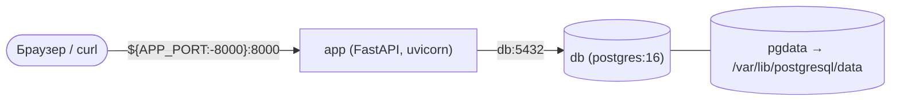

# Схема окружения проекта

> Бланк для воркшопа №3. Скопируйте файл в свой репозиторий как `docs/environment-schema.md`
> и заполните на занятии. Схема — техническое задание для практики №3: по ней вы напишете
> compose-файл. Раздел 4 заполняет **другая команда**, раздел 5 — снова вы. Что сделать после
> занятия — в разделе 6.
>
> Скопировать бланк из корня своего репозитория:
>
> ```bash
> # macOS / Linux / Git Bash
> curl -fsSL --create-dirs -o docs/environment-schema.md https://raw.githubusercontent.com/andrey-limasov/app-conf/main/workshops/workshop3/environment-schema-template.md
> # Windows PowerShell
> curl.exe -fsSL --create-dirs -o docs/environment-schema.md https://raw.githubusercontent.com/andrey-limasov/app-conf/main/workshops/workshop3/environment-schema-template.md
> ```
>
> Ключ `-f` нужен, чтобы при ошибке скачивания `curl` завершился с ошибкой, а не записал в файл текст `404: Not Found`. `--create-dirs` создаёт папку `docs/`, если её нет: без него `curl` падает с `curl: (23) client returned ERROR on write` — так бывает у команд на GitFlow, у которых `docs/` с ADR 001 есть только в `main`.
>
> Изменения бланка: 2026-10-11 — `--create-dirs` в командах копирования; вопрос 1 раздела 3 — переменная со строкой подключения целиком; где и как рецензент заполняет раздел 4 (вне воркшопа — комментарием в PR); `APP_PORT` для порта приложения; в разделе 6 — синхронизация `develop` для GitFlow, инструмент вне `venv/`, тег образа `python` = версия Python проекта из README, новые строки таблицы замен ADR 002. Сданные схемы и ADR 002 переделывать не нужно: расхождения поправит практика №3 (шаги 5.5 и 6.2).

**Команда:** repair-requests
**Проект:** Учёт заявок на ремонт оборудования — сотрудники подают заявки на ремонт, инженеры АХО принимают и закрывают их
**Дата:** 2026-10-09

## 0. Кто что делал

Заполняется для взаимооценки внутри команды. Роли можно совмещать, но у каждого участника должна быть хотя бы одна.

| Участник | Роль на воркшопе | Что конкретно сделал |
|---|---|---|
| Иван Петров | Архитектор схемы | Нарисовал схему (раздел 1), ответил на вопросы 1–2 раздела 3 |
| Мария Соколова | Ведущий таблицы сервисов | Заполнила таблицу сервисов (раздел 2), ответы на вопросы 3–5 |
| Олег Ким | Автор ADR 002 | Таблица сравнения pip / Poetry / uv, черновик ADR 002 |
| Мария Соколова | Рецензент (проверяет схему другой команды) | Проверила схему команды «Бронирование лабораторных стендов» |

## 1. Схема

Нарисуйте сервисы, связи между ними, опубликованные порты и тома. Подойдут Mermaid, фото рисунка на бумаге (файл положить в `docs/img/`) или ASCII-схема. В шаблоне Mermaid меняйте текст внутри кавычек, сами кавычки оставьте — без них квадратные скобки в подписях ломают схему.



## 2. Таблица сервисов

| Сервис | Образ или сборка | Порты `хост:контейнер` | Переменные окружения (только имена, без значений) | Тома | Зависит от (условие) | Healthcheck |
|---|---|---|---|---|---|---|
| `app` | `build: .` (Dockerfile на базе `python:3.14-slim`) | `${APP_PORT:-8000}:8000` — браузер и `curl` разработчика | `DATABASE_URL` | — | `db` (`service_healthy`) | — (появится позже) |
| `db` | `postgres:16` | `5432:5432` — подключаться к базе из IDE (DBeaver) | `POSTGRES_USER`, `POSTGRES_PASSWORD`, `POSTGRES_DB` | `pgdata:/var/lib/postgresql/data` (именованный) | — | `pg_isready -U postgres`, каждые 5 с, 5 попыток |

Если сервисов больше двух (например, Redis), для каждого дополнительного укажите одной фразой, зачем он нужен именно сейчас.

Порт хоста приложения запишите переменной: `${APP_PORT:-8000}:8000` — тот, у кого 8000 занят, сменит его в своём `.env`. На практике №3 так делают все.

## 3. Ответы на контрольные вопросы

1. **Адрес базы.** Хост — имя сервиса базы `db` в сети Compose (не `localhost`: внутри контейнера `app` это он сам). Шаблон: `postgresql://postgres@db:5432/repair_requests`. Строку целиком вместе с паролем приложение получит в переменной `DATABASE_URL`
2. **Судьба данных.** После `docker compose down` контейнеры удаляются, а именованный том `pgdata` остаётся — данные сохранятся. После `docker compose down -v` удаляется и том — база при следующем `up` создаётся пустой
3. **Образ и запуск.** В образ при сборке: базовый `python:3.14-slim`, зависимости из lock-файла, код приложения. Только при запуске: переменные окружения (`DATABASE_URL`, пароль базы из `.env`), публикация портов, тома
4. **Миграции.** Гипотеза: на этом этапе база создаётся пустой (`POSTGRES_DB`), таблицы появятся с миграциями в модуле 3 (Alembic при старте приложения)
5. **Запуск и проверка.** `docker compose up --build`; затем `curl http://localhost:8000/health` — ожидаемый ответ `{"status":"healthy"}`

## 4. Проверка схемы другой командой

**Команда-рецензент:** Бронирование переговорных
**Рецензент:** Дмитрий Орлов, @dmitry-orlov

На воркшопе рецензент заполняет этот раздел прямо в файле авторов, на их ноутбуке; авторы коммитят раздел 4 отдельным коммитом с `--author` рецензента, затем заполняют раздел 5. Вне воркшопа (домашнее задание практики №3) рецензент пишет раздел 4 ревью-комментарием в PR со схемой, а авторы переносят его в файл тем же способом.

### Как проверять: 8 минут

| Время | Что делать |
|---|---|
| 1 мин | Прочитать схему целиком, молча. Понять, что за приложение и из каких сервисов оно состоит. Вопросов пока не задавать |
| 3 мин | Пройти чек-лист сверху вниз. По каждому критерию найти в схеме **конкретное место** — колонка «Где смотреть» подсказывает какое. Нашли и всё верно — ✅. Не нашли или неверно — ❌. Нашли, но сомневаетесь — ⚠️ и вопрос авторам. В комментарий — где смотрели и что увидели |
| 1 мин | **Холодное чтение.** Представьте, что на практике №3 вы пишете compose-файл по этой схеме, а авторов рядом нет. Пройдите мысленно по будущему файлу: сервисы, образы, порты, переменные, тома, зависимости, команда запуска. Запишите, чего не хватило |
| 2 мин | Из ❌ и ⚠️ выбрать **до двух главных замечаний** — те, из-за которых стек не поднимется на практике №3. Адрес базы, том и порядок старта важнее оформления. Нет ни ❌, ни ⚠️ — не придумывайте замечаний: напишите «Блокирующих замечаний нет» и проверьте, что у каждого ✅ есть комментарий |
| 1 мин | Записать рекомендацию или вопрос за пределами чек-листа. Проверить, что вписаны ваше имя и логин |

**Вопросы авторам** задавайте, только когда схема не отвечает сама. Если ответ автора в схеме не записан — это замечание, даже если ответ правильный: на практике №3 по схеме будут писать compose-файл, а не по устным пояснениям.

**Замечание строится по формуле:** где → что не так → чем это грозит → что предлагаете.

| Не замечание | Замечание |
|---|---|
| «Всё хорошо» — без указания, где проверяли | «Раздел 2, строка `db`: образ `postgres` без тега. Завтра скачается другая версия, и путь тома может не подойти. Предлагаем `postgres:16`» |
| «Непонятно с базой» | «Вопрос 1: приложение подключается к `localhost:5432`. Внутри Compose это сам контейнер приложения, база не найдётся. Предлагаем хост `db` — имя сервиса из вашей таблицы» |
| «Надо доработать порты» | «Раздел 2, строка `db`: порт `5432:5432` открыт наружу, зачем — не сказано. Если снаружи к базе никто не ходит, предлагаем убрать» |

**Схема без замечаний — нормальный результат,** если он доказан: у каждого ✅ в комментарии указано, где в схеме вы это увидели. Выдуманное замечание хуже честного «замечаний нет»: авторы потратят время на проблему, которой нет.

**Замечание и рекомендация — разные вещи.** Замечание — схема нарушает критерий, стек не поднимется. Рекомендация или вопрос — то, что схема не обязана решать сейчас, но стоит обдумать. Например: «что будет, если у кого-то занят порт 8000?», «чем окружение на сервере будет отличаться от этого?», «куда приложение будет писать логи?». Рекомендация или вопрос есть в каждом ревью.

Проверяется схема, а не люди. Не переписывайте схему за авторов: ваша задача — показать, где она не сработает.

### Чек-лист

Отметьте каждый пункт: ✅ выполнено, ❌ не выполнено, ⚠️ спорно. Для ❌ и ⚠️ комментарий обязателен. Если блокирующих замечаний нет — комментарий обязателен для каждого пункта: где в схеме вы это увидели.

| № | Критерий | Где смотреть | Оценка | Комментарий |
|---|---|---|---|---|
| 1 | В стеке есть приложение и PostgreSQL; каждый дополнительный сервис обоснован | Раздел 2: строки сервисов; у каждого сверх двух — фраза «зачем» | ✅ | Раздел 2: две строки — `app` и `db`, дополнительных сервисов нет |
| 2 | Версия образа БД зафиксирована (не `latest` и не без тега) | Раздел 2, строка БД, колонка «Образ»: после двоеточия — конкретная версия | ✅ | Раздел 2, строка `db`: `postgres:16` |
| 3 | Приложение обращается к БД по адресу, который работает **внутри** сети Compose | Раздел 3, вопрос 1: хост в строке подключения сравнить с именами сервисов в разделе 2 | ✅ | Раздел 3, вопрос 1: хост `db` — совпадает с именем сервиса в разделе 2 |
| 4 | Данные БД хранятся в именованном томе, путь монтирования соответствует версии PostgreSQL | Раздел 2, строка БД, колонка «Тома»: у тома есть имя; путь сверить с версией образа по описанию образа postgres (раздел PGDATA) | ✅ | Раздел 2, строка `db`: том `pgdata`, путь `/var/lib/postgresql/data` — для 16 верно по разделу PGDATA |
| 5 | Приложение стартует только после того, как БД готова (условие в зависимости + healthcheck у БД) | Раздел 2: у приложения колонка «Зависит от» — с условием; у БД колонка «Healthcheck» заполнена | ⚠️ | Раздел 2: у `app` — `service_healthy`, у `db` healthcheck есть, но 5 попыток по 5 с = 25 с; хватит ли на первую инициализацию? |
| 6 | Наружу опубликованы только нужные порты; для каждого опубликованного порта понятно, зачем | Раздел 2, колонка «Порты»: для каждого порта — кто к нему ходит снаружи | ✅ | Раздел 2: 8000 — браузер и curl, 5432 — IDE; для каждого написано, кто ходит |
| 7 | Переменные окружения перечислены по именам, значений секретов в схеме нет | Раздел 2, колонка переменных; раздел 3, вопрос 1: нигде нет паролей | ✅ | Раздел 2 и вопрос 1: только имена, паролей нет |
| 8 | Есть ответ, как создаётся схема БД при первом запуске | Раздел 3, вопрос 4 (гипотеза допустима) | ✅ | Раздел 3, вопрос 4: гипотеза отмечена |
| 9 | Стек поднимается одной командой, есть проверяемый признак успешного запуска | Раздел 3, вопрос 5: команда и что именно проверить после неё | ✅ | Раздел 3, вопрос 5: `docker compose up --build` и `/health` |

**Главные замечания** — до двух, по формуле «где → что не так → чем грозит → что предлагаете». Если блокирующих проблем нет, напишите вместо них: «Блокирующих замечаний нет».

1. Раздел 2, строка `db`, колонка «Healthcheck»: `pg_isready` — 5 попыток по 5 секунд без запаса на первый старт. На Docker Desktop первая инициализация базы может идти дольше, `db` станет `unhealthy`, и `app` не запустится. Предлагаем увеличить число попыток и добавить `start_period`
2. —

**Холодное чтение.** Смогли бы вы написать compose-файл по этой схеме, не спрашивая авторов? Чего не хватило — имени переменной, порта приложения, версии образа, команды запуска, чего-то ещё? Если чего-то не хватает и без этого стек не поднимется — перенесите это в главные замечания; если без этого можно обойтись — в рекомендации. Если хватило всего — так и напишите.

- Compose-файл по схеме написать можно; не хватило имени базы в колонке переменных — нашли только в вопросе 1 (`repair_requests`). Не блокирует

**Рекомендация или вопрос** за пределами чек-листа (обязательно в каждом ревью):

- Что будет, если у кого-то на ноутбуке уже стоит PostgreSQL и порт 5432 занят?

## 5. Что изменено по замечаниям

Заполняют авторы после проверки.

| Замечание или рекомендация | Что изменили, почему не согласны или учтёте ли рекомендацию |
|---|---|
| | |

## 6. После воркшопа

Раздел не заполняется — это домашнее задание к практике №3. Схема и ADR 002 живут в **разных ветках**: у них разная судьба, и одна ветка на два PR не годится. Имена веток — по вашим правилам из `CONTRIBUTING.md`, например `docs/environment-schema` и `docs/adr-002-dependency-manager`. Команды на GitFlow создают обе ветки и ветку задания 3 от `develop` и открывают PR в `develop`. Перед этим синхронизируйте `develop` с `main` командами блока `docs/sync-main-into-develop` из шага 1.1 [практики №3](https://github.com/andrey-limasov/app-conf/blob/main/practices/practice3/practice-3-guide.md), её «Подготовка» требует этого до занятия. Последнюю команду блока (`git checkout -b feature/containerize`) не выполняйте — это рабочая ветка практики. PR синхронизации смержите до создания остальных веток: тогда в `develop` будут `docs/`, ADR 001 и файлы зависимостей, а PR схемы и ADR не потащат файлы синхронизации.

| № | Задание | Критерий готовности | Срок |
|---|---|---|---|
| 1 | Доработать схему по разделу 4, заполнить раздел 5 | `docs/environment-schema.md` смержен через PR с approval сокомандника в основную ветку разработки (`main` или `develop` по вашей стратегии) | 3 дня после воркшопа |
| 2 | Дописать ADR 002 | `docs/adr/002-dependency-manager.md`: все разделы шаблона заполнены, статус «Предложено», PR открыт, но **не смержен** — статус «Принято» ADR получит на практике №3 | К практике №3 |
| 3 | Подготовить инструмент | Каждый участник установил выбранный в ADR инструмент **вне `venv/` проекта**: uv — [установщиком](https://docs.astral.sh/uv/getting-started/installation/), Poetry — [через pipx](https://python-poetry.org/docs/#installing-with-pipx); `uv --version` или `poetry --version` отвечает при неактивном `venv/` (после `deactivate`). В `.gitignore` добавлена строка `.venv/` отдельным PR с сообщением `chore: ignore .venv`, PR смержен — uv по умолчанию создаёт окружение в `.venv`; строка нужна всем командам, в том числе на Poetry, — это входное требование практики №3. Выполнен `docker pull` образа `python:<версия>-slim`, где версия — версия Python проекта из README (практика №1: минимальная в команде), например `python:3.12-slim`. На практике №3 этот тег встанет в `Dockerfile` | К практике №3 |

### Как писать ADR 002 по шаблону ADR 001

Скопировать шаблон в ветку ADR:

```bash
# macOS / Linux / Git Bash
curl -fsSL --create-dirs -o docs/adr/002-dependency-manager.md https://raw.githubusercontent.com/andrey-limasov/app-conf/main/workshops/workshop2/adr-template.md
# Windows PowerShell
curl.exe -fsSL --create-dirs -o docs/adr/002-dependency-manager.md https://raw.githubusercontent.com/andrey-limasov/app-conf/main/workshops/workshop2/adr-template.md
```

Шаблон написан под стратегии ветвления. Что заменить:

| Раздел шаблона | Что писать в ADR 002 |
|---|---|
| Заголовок | `# ADR 002: Выбор менеджера зависимостей` |
| Врезка-цитата под заголовком (указания по копированию шаблона) | Удалить |
| Контекст → «Уровень опыта команды с Git» | Опыт команды с pip, Poetry, uv; чем проект управляет зависимостями сейчас |
| Контекст → «Требования к стабильности `main`» | Требования к воспроизводимости окружения: у всех участников и в образе — одни версии пакетов и Python |
| Контекст → «Проблема» | Ваш список проблем с воркшопа из колонки «Менеджер зависимостей» на доске; не были на воркшопе — проблемы вашего текущего `requirements.txt` или `pyproject.toml` |
| Рассмотренные варианты A/B/C | A — pip + `requirements.txt`, B — Poetry, C — uv. В начало раздела — таблица сравнения по критериям ниже |
| Решение → «Схема ветвления» | «Как ставятся зависимости»: команда для разработчика и команда для Dockerfile (гипотеза до практики №3) |
| Решение → «Правила работы с ветками» | Какие файлы коммитятся (`pyproject.toml`, lock-файл), как добавляется зависимость, как ставятся dev-зависимости. Правило 6 «Защита веток» удалить |
| Обоснование → размер команды, частота релизов | Критерии, по которым выбранный вариант выигрывает |
| Связь с другими ADR → «Этот ADR является первым» | Ссылка на ADR 001 |
| Источники | Документация выбранного и отвергнутых инструментов, которой вы пользовались |

Критерии сравнения (минимум пять) и где искать ответ:

| Критерий | Где искать |
|---|---|
| Lock-файл: разделены ли прямые и транзитивные зависимости, есть ли хеши | Откройте lock-файл после пробной установки; для pip — `requirements.txt` после `pip freeze` |
| Фиксация версии Python | [uv: Working on projects](https://docs.astral.sh/uv/guides/projects/), [Poetry: Basic usage](https://python-poetry.org/docs/basic-usage/) |
| Разделение основных и dev-зависимостей | [uv: Managing dependencies](https://docs.astral.sh/uv/concepts/projects/dependencies/), [Poetry: Managing dependencies](https://python-poetry.org/docs/managing-dependencies/) |
| Установка строго по lock-файлу | [uv: Locking and syncing](https://docs.astral.sh/uv/concepts/projects/sync/), [Poetry: CLI](https://python-poetry.org/docs/cli/) — команды `install`, `sync`, `check --lock` |
| Скорость установки | Документация инструмента, пробная установка |
| Как инструмент ставится в Docker-образ | Гипотеза, проверяется на практике №3 |
| Стоимость перехода с текущего состояния проекта | Ваш репозиторий |
| Зрелость, документация, распространённость | Документация инструмента |
| Опыт команды | Команда |
